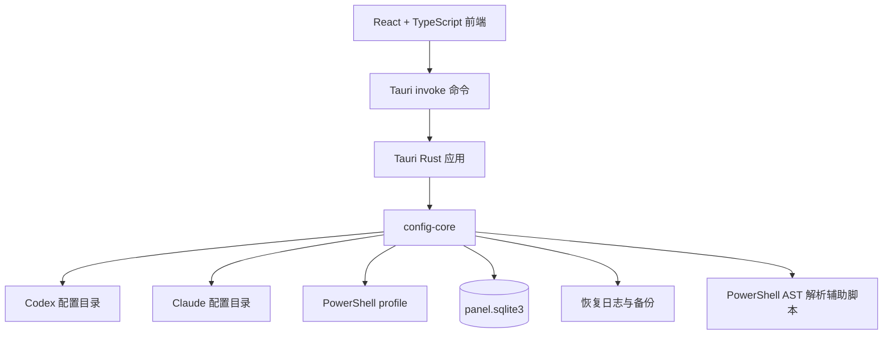

# CLI Auto Panel

一个面向 Windows 的本地桌面配置管理面板，用于集中管理 Claude Code 与 Codex 的别名配置、通用配置和 PowerShell 命令入口。

> 技术栈：React + TypeScript + Vite + Tauri 2 + Rust  
> 运行方式：本地桌面应用，不依赖常驻云端服务

## ✨ 项目简介

CLI Auto Panel 解决 Claude Code 与 Codex 无法无法同时运行多个API，多个配置文件之间重复编辑、手动维护别名和配置同步困难的问题。

它可以：

- 发现并管理 Claude Code 与 Codex 的命名配置文件；
- 在单个界面中编辑 TOML / JSON 配置；
- 创建、导入、重命名和删除配置别名；
- 从配置文件提取通用配置，应用到多个绑定文件；
- 在保存前展示实际文件变化和通用配置差异；
- 精确维护 PowerShell profile 中的命令入口；
- 使用本地 SQLite 保存面板状态；
- 在文件写入过程中保留恢复日志，支持恢复未完成的操作；
- 通过文件哈希、版本和路径校验避免覆盖外部修改。

## 🧭 工作流

应用将配置变更拆分为“读取、预览、确认、提交”几个阶段：


变更计划在提交前不会写入实际配置文件。检测到外部修改、路径越界、文件格式异常或未完成的上一次操作时，应用会停止提交并提示处理。

## 🏗️ 架构



前端只通过 `src/api.ts` 调用 Tauri 命令；文件路径校验、格式解析、合并、差异计划、SQLite 状态管理和恢复逻辑集中在 `crates/config-core` 中。

## 🧰 主要功能

### 配置别名

默认管理以下命名配置文件：

| 类型 | 文件模式 | 默认目录 |
| --- | --- | --- |
| Codex | `config.<名称>.toml` | `%USERPROFILE%\.codex` |
| Claude Code | `settings.<名称>.json` | `%USERPROFILE%\.claude` |

Claude Code 的 `settings.local.json` 属于本地配置，不会被作为别名配置自动管理。

Claude Code 与 Codex 的配置根目录可以通过环境变量覆盖：

```text
CODEX_HOME
CLAUDE_CONFIG_DIR
```

覆盖值必须是绝对路径。

### 通用配置

通用配置保存在面板自己的本地状态中，可以绑定到多个配置文件。应用通用配置时，会根据 TOML 或 JSON 的结构执行合并，并在保存前展示实际结果。

常见操作包括：

- 新建和编辑通用配置；
- 将当前配置提取为通用配置；
- 将通用配置应用到一个或多个绑定；
- 查看待同步和已同步状态；
- 删除模板及其绑定关系；
- 按分组组织配置。

配置提取包含对常见敏感字段和环境变量的过滤规则，但这不能替代人工审阅。保存前请始终检查预览内容。

### PowerShell profile

应用默认读取：

```text
%USERPROFILE%\Documents\PowerShell\Microsoft.PowerShell_profile.ps1
```

它会解析已有的 Claude Code 与 Codex 命令入口，并在变更计划确认后维护对应内容。应用不会自动执行 profile 中的命令；已经打开的 PowerShell 终端也不会自动重载，通常需要新开终端才能看到别名变化。

### 本地状态与恢复

面板状态默认保存在 Windows 本地应用数据目录：

```text
%LOCALAPPDATA%\CliAutoPanel\panel.sqlite3
```

同一目录还可能包含实例锁、操作日志和恢复所需的备份内容。具体目录由 Rust `dirs` 库根据操作系统返回。

## 🔒 安全与隐私

本项目会读取和修改用户本地的 CLI 配置文件、PowerShell profile 以及面板本地状态。配置文件可能包含 API 密钥、令牌、账号信息或其他敏感内容。

## 🚀 开始开发

安装前端依赖：

```powershell
npm ci
```

启动 Tauri 桌面开发模式：

```powershell
npm run dev
```

只启动 Vite 前端开发服务器：

```powershell
npm run dev:renderer
```

前端类型检查和生产构建：

```powershell
npm run build:renderer
```

构建 Tauri 应用：

```powershell
npm run build
```

首次运行前，请确认当前用户已经安装并能正常使用目标 CLI、PowerShell profile 路径可访问，并且配置目录中的文件没有被其他程序持续占用。

## 🧪 验证建议

本项目当前没有单独的自动化测试脚本。提交代码前，建议至少完成：

1. 前端类型检查和构建；
2. Tauri 开发模式启动；
3. Codex 配置的读取、编辑、预览和恢复流程；
4. Claude Code 配置的读取、编辑、预览和恢复流程；
5. PowerShell profile 中别名的创建、重命名和删除；
6. 外部修改、无效配置、删除模板和未完成恢复日志等异常路径。

## 📁 项目结构

```text
.
├─ crates/
│  └─ config-core/
│     ├─ scripts/              # PowerShell AST 解析辅助脚本
│     └─ src/
│        ├─ discovery.rs       # 配置文件发现与路径边界校验
│        ├─ extract.rs         # 通用配置提取与敏感字段过滤
│        ├─ files.rs           # 文件读取、编码、哈希与原子替换
│        ├─ journal.rs         # 操作日志、备份与恢复
│        ├─ merge_json.rs      # JSON 配置合并
│        ├─ merge_toml.rs      # TOML 配置合并
│        ├─ planner.rs         # 变更计划与提交前校验
│        ├─ profile_editor.rs  # PowerShell profile 编辑
│        ├─ repository.rs      # SQLite 面板状态存储
│        └─ lib.rs             # 核心引擎入口
├─ src/
│  ├─ components/              # 通用 React 组件
│  ├─ features/
│  │  ├─ aliases/              # 别名、配置和分组界面
│  │  ├─ common-config/        # 通用配置编辑
│  │  ├─ drag/                 # 拖拽排序
│  │  └─ preview/              # 差异预览
│  ├─ api.ts                   # 前端到 Tauri 的调用协议
│  ├─ App.tsx                  # 应用页面和导航
│  ├─ styles.css               # 全局样式
│  └─ types.ts                 # 前后端共享数据类型
├─ src-tauri/
│  ├─ src/main.rs              # Tauri 入口和命令注册
│  ├─ capabilities/            # Tauri 权限配置
│  └─ tauri.conf.json          # 桌面应用配置
├─ package.json
├─ src-tauri/Cargo.toml
└─ README.md
```

## 🛠️ 设计原则

项目实现遵循以下原则：

- **本地优先**：配置和状态默认留在用户设备上；
- **预览后提交**：先生成变更计划，再由用户确认写入；
- **快速失败**：路径越界、格式错误、外部修改和状态冲突会停止操作；
- **可恢复**：跨文件变更通过操作日志和备份支持恢复；
- **边界清晰**：前端负责交互，Rust 核心负责文件、解析和状态一致性；
- **最小权限**：只管理符合命名规则且位于允许目录中的配置文件。

## 🤝 贡献

欢迎提交 Issue 或 Pull Request。